# Architecture

A build-time static site with no backend. `npm run collect` turns the fictional sample exports into a versioned JSON dataset in `public/data/`; the site loads that same-origin file with a relative URL (so it works under `/poc-usage-dashboard/`), falling back to the adapters bundled in a lazy chunk, and runs pure engines in the browser. Nothing contacts a third-party host, account, or live usage API.

```mermaid
flowchart LR
  subgraph samples["data/sample/ (fictional)"]
    G[grok-bot-usage.json]
    C[cursor-usage.csv]
    A[azure-cost-management.csv]
    L[llm-api-usage.csv]
  end
  subgraph adapters["src/adapters/"]
    AD["grok-bot · cursor · azure · llm-api<br/>parse + map + validateRecord()"]
    REG["registry.ts (adapters)<br/>sources.ts (labels, units, colors)"]
  end
  PIPE["src/data/pipeline.ts + quality.ts<br/>validate all rows · dedupe · sort · coverage"]
  OUT[("public/data/<br/>usage.v1.json + manifest.json")]
  LOAD["src/data/load.ts<br/>loadUsageData()"]
  subgraph engines["pure engines (src/)"]
    AGG[aggregate]
    BUD["budgets<br/>+ config/budgets.json"]
    FC[forecast]
    AN[anomaly]
    AL[allocation]
    INS[insights]
  end
  UI["src/ui/ views<br/>overview · assistant · source · budgets · forecast · anomalies"]
  DIST[("dist/ static files")]
  PAGES["GitHub Pages<br/>/poc-usage-dashboard/"]
  G & C & A & L --> AD --> REG
  REG -- "npm run collect (build time)" --> PIPE --> OUT
  OUT -- "fetch ./data/* (same origin)" --> LOAD
  REG -. "fallback: dynamic import" .-> LOAD
  LOAD --> engines --> UI --> DIST --> PAGES
```

## Pieces

- **Schema** (`src/schema/usage.ts`): `UsageRecord { date, source, assistant_or_project, units, unit_type, cost_usd }`, `validateRecord(s)`, and `UsageAdapter` (async `load()`). `source` is `'grok-bot' | 'cursor' | 'azure' | 'llm-api'`.
- **Adapters** (`src/adapters/<source>.ts`): one per source. Each parses a raw sample under `data/sample/`, maps to `UsageRecord`, and validates. A `// REAL DATA PLUGS IN HERE` comment marks where a live export would replace the sample read. See [adapters.md](adapters.md).
- **Registry** (`src/adapters/registry.ts`, metadata in `sources.ts`): the single list of sources (label, unit, color, adapter). The UI imports metadata without pulling in the bundled samples. `loadAllUsage()` in `src/adapters/index.ts` runs every registered adapter.
- **Collect and load**: `npm run collect` (`scripts/collect.mjs` → `scripts/collect-run.ts`) runs every adapter through `normalizeBatches()`, which validates every row (all errors at once), drops exact duplicates on day × source × assistant × unit type, and fails on conflicting duplicates. It writes a versioned dataset and a manifest (counts, date range, per-source totals). `generated_at` comes from the last data day, so output is byte-identical across runs; `collect:check` fails if the committed files are stale. `src/data/load.ts` fetches `./data/manifest.json` then the dataset it names, re-validates, and on any problem falls back to a dynamic import of the bundled adapters (which also keeps ~440 kB of raw samples out of the initial chunk).
- **Engines** (pure TypeScript, no DOM, no fetch; math in [analytics.md](analytics.md)): `src/aggregate.ts` (ISO weeks, by assistant, top consumers, filters), `src/budgets.ts` + `config/budgets.json`, `src/forecast.ts`, `src/anomaly.ts`, `src/allocation.ts`, `src/data/quality.ts`, `src/insights.ts`.
- **UI** (`src/ui/`, entry `src/ui/main.ts`): a small hash router, URL-synced filters, lazy views (overview, assistant, source, budgets, forecast, anomalies), Chart.js on demand, theme, and export. See [UI.md](UI.md). Shared date/label helpers still live in `src/app/`.
- **Build**: `vite build` writes `dist/` with relative asset paths (`base: './'`). The Pages workflow sets `VITE_BASE=/poc-usage-dashboard/` and publishes `dist/` to GitHub Pages (Jose's approved v2 exception). No other deploy or custom domain.

## Quality gates

- **CI** (`.github/workflows/ci.yml`, `permissions: contents: read`, `ubuntu-24.04`): `npm ci` (with `PLAYWRIGHT_SKIP_BROWSER_DOWNLOAD=1`) → typecheck → hard-limits scan → `collect:check` → tests with coverage thresholds (88% lines/statements/functions, 80% branches) → build → assert `dist/index.html` exists → bundle-size budget → documentation link check → Playwright e2e smoke tests. Runs on pull requests and pushes to `main`. Dependabot is configured (config file only) for npm and GitHub Actions.
- **Tests**: Vitest unit tests for the schema, adapters, engines, and UI (happy-dom), plus Playwright e2e against the built site (system Chrome locally; cached Chromium in CI).
- **Limits scanner** (`scripts/limits.ts`): secrets and hardware-identifier patterns, run as part of `npm test` and as a separate named CI step.
- **Pages** (`.github/workflows/pages.yml`): official `configure-pages` / `upload-pages-artifact` / `deploy-pages` actions on push to `main` and `workflow_dispatch`. Enablement is a one-time Settings → Pages → Source: GitHub Actions step, because creating a Pages site also requires `administration:write`.
