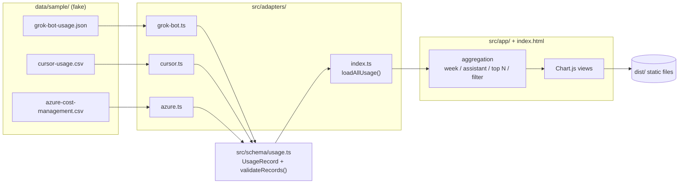
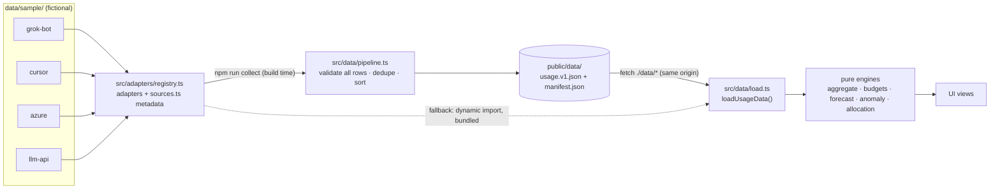

# Architecture

A build-time static site. There is no backend and no runtime network call: sample data is bundled into the JavaScript at build time by Vite.

## Pieces

- **Schema** (`src/schema/usage.ts`): the one contract. `UsageRecord { date, source, assistant_or_project, units, unit_type, cost_usd }`, `validateRecord(s)` with clear errors, and the `UsageAdapter` interface (async `load()`).
- **Adapters** (`src/adapters/<source>.ts`): one per source. Each parses its raw, source-shaped sample (`data/sample/`, named after each source's native export), maps to `UsageRecord`, and validates. The `REAL DATA PLUGS IN HERE` comment marks where a live export would replace the sample read.
- **Registry** (`src/adapters/index.ts`): `loadAllUsage()` runs every adapter and concatenates results. It's the only thing the app imports from the data layer.
- **Aggregation** (`src/aggregate.ts`): pure functions over `UsageRecord[]`: spend by ISO week (Monday start, computed from the calendar date), spend by assistant, top consumers, week-over-week, and filtering by source. Pure so it's unit-testable without a browser. Other tracks should import this module rather than reimplementing it.
- **Views** (`index.html`, `src/app/`): Chart.js charts for spend by week (trend lines), spend by assistant, top consumers, plus the source filter controls.
- **Build**: `vite build` produces `dist/` with relative asset paths (`base: './'`) so it can be served from any folder. The Pages workflow overrides this with `VITE_BASE=/usage-dashboard-trial/` and publishes `dist/` to GitHub Pages (Jose's approved v2 exception). No other deploy or custom domain.

## Quality gates

- **CI** (`.github/workflows/ci.yml`, GitHub Actions, `permissions: contents: read`): `npm ci` → typecheck → hard-limits scan → tests with coverage thresholds → build → assert `dist/index.html` exists → bundle-size budget → documentation link check → Playwright e2e smoke tests (system Chrome locally; cached Chromium in CI). Runs on pull requests and pushes to `main`. Dependabot is configured (config file only) for npm and GitHub Actions.
- **Tests** (Vitest): schema validation, each adapter against its sample, aggregation, a DOM-level render test of the dashboard (happy-dom), and the limits scanner.
- **Limits scanner** (`scripts/limits.ts`): secrets and hardware-identifier patterns, run as part of `npm test` and as a separate named CI step.

## v2 data platform (track A)

- **Registry** (`src/adapters/registry.ts`, metadata in `sources.ts`): every source's display name, unit type, color, and adapter. See docs/adapters.md, "Adding a source".
- **Collect** (`npm run collect` → `scripts/collect.mjs` → `scripts/collect-run.ts`): runs every registered adapter through `normalizeBatches()`, which validates every row (all errors reported at once, with source, index, and a row snippet), drops exact duplicates on the natural key day × source × assistant × unit type, and fails on conflicting duplicates. Writes a versioned dataset and a manifest (counts, date range, per-source totals, schema version). `generated_at` is derived from the last data day, so output is byte-identical across runs; a test fails if the committed files are stale.
- **Load** (`src/data/load.ts`): the site fetches `./data/manifest.json` then the dataset it names, re-validates, and checks the record count. On any problem it falls back to the bundled adapters through a dynamic import, which also keeps ~440 kB of raw samples out of the initial chunk.
- **Engines** (pure, documented in [analytics.md](analytics.md)): `src/budgets.ts` + `config/budgets.json` (burn, % used, run-rate projection, ok/warn/over).
- `src/forecast.ts`: next 4 weeks of spend per source or total, linear (OLS + prediction interval) or EWMA, with a low/high band.
- `src/anomaly.ts`: rolling z-score spike detection per total, source, or source × assistant.
- `src/allocation.ts`: per-assistant cost across sources, cost per unit, and one assistant's weekly drill-down.
