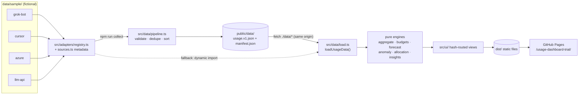

# Architecture

A build-time static site. There is no backend and no call to a live usage API. Adapters turn fictional, source-shaped samples into a common `UsageRecord`. `npm run collect` writes `public/data/usage.v1.json` and a manifest; the UI fetches those files from the same origin (relative URLs) and falls back to bundled adapters if that fails.

## Pieces

- **Schema** (`src/schema/usage.ts`): `UsageRecord { date, source, assistant_or_project, units, unit_type, cost_usd }`, `validateRecord(s)`, and `UsageAdapter` (async `load()`). `source` is `'grok-bot' | 'cursor' | 'azure' | 'llm-api'`.
- **Adapters** (`src/adapters/<source>.ts`): one per source. Each parses a raw sample under `data/sample/`, maps to `UsageRecord`, and validates. A `// REAL DATA PLUGS IN HERE` comment marks where a live export would replace the sample read. See [adapters.md](adapters.md).
- **Registry** (`src/adapters/registry.ts`, metadata in `sources.ts`): the single list of sources (label, unit, color, adapter). The UI imports metadata without pulling in the bundled samples.
- **Collect and load**: `npm run collect` writes a versioned dataset and manifest (byte-stable; `generated_at` comes from the last data day). `src/data/load.ts` fetches them with a relative URL so the site works under `/usage-dashboard-trial/`, then falls back to a dynamic import of the adapters.
- **Engines** (pure TypeScript, no DOM, no fetch): `src/aggregate.ts` (ISO weeks, by assistant, top consumers, filters), `src/budgets.ts`, `src/forecast.ts`, `src/anomaly.ts`, `src/allocation.ts`, `src/data/quality.ts`, `src/insights.ts`. See [analytics.md](analytics.md).
- **UI** (`src/ui/`, entry `src/ui/main.ts`): a small hash router, URL-synced filters, lazy views (overview, assistant, source, budgets, forecast, anomalies), Chart.js on demand, theme, and export. See [UI.md](UI.md). Shared date/label helpers still live in `src/app/`.
- **Build**: `vite build` writes `dist/` with relative asset paths (`base: './'`). The Pages workflow sets `VITE_BASE=/usage-dashboard-trial/` and publishes `dist/` to GitHub Pages (Jose's approved v2 exception). No other deploy or custom domain.

## Quality gates

- **CI** (`.github/workflows/ci.yml`, `permissions: contents: read`, `ubuntu-24.04`): `npm ci` (with `PLAYWRIGHT_SKIP_BROWSER_DOWNLOAD=1`) → typecheck → hard-limits scan → `collect:check` → tests with coverage thresholds (88% lines/statements/functions, 80% branches) → build → assert `dist/index.html` exists → bundle-size budget → documentation link check → Playwright e2e smoke tests. Runs on pull requests and pushes to `main`. Dependabot is configured (config file only) for npm and GitHub Actions.
- **Tests**: Vitest unit tests for the schema, adapters, engines, and UI (happy-dom), plus Playwright e2e against the built site (system Chrome locally; cached Chromium in CI).
- **Limits scanner** (`scripts/limits.ts`): secrets and hardware-identifier patterns, run as part of `npm test` and as a separate named CI step.
- **Pages** (`.github/workflows/pages.yml`): official `configure-pages` / `upload-pages-artifact` / `deploy-pages` actions on push to `main` and `workflow_dispatch`. Enablement is a one-time Settings → Pages → Source: GitHub Actions step, because creating a Pages site also requires `administration:write`.
